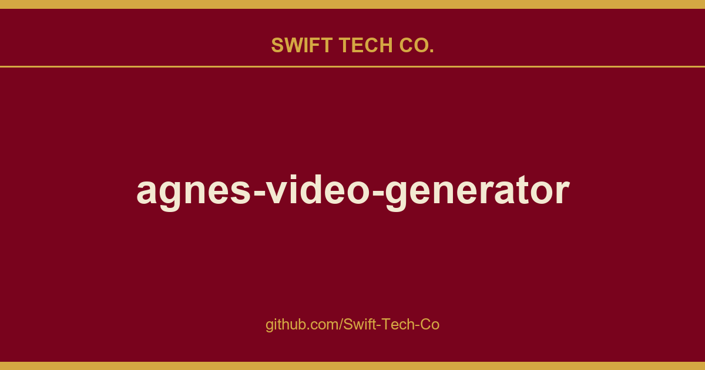

# agnes-video-generator

## What This Is

We keep a working index for product and engineering, and agnes-video-generator is the entry that collects our notes, examples and fixes. It reflects how Swift Tech Co. actually uses this in builds and client work.

## Images

[](https://github.com/Swift-Tech-Co/agnes-video-generator)

## 🚀 Two Ways to Use  Both Completely Free

| Project | Run Where | Features | Link |
|---------|-----------|----------|------|
| **Agnes Video Generator** (this project) | **Download & run locally** | **More powerful**  TTS narration, auto subtitles, digital anchor, image-to-video, keyframes animation, manuscript-to-video, checkpoint resume & more | GitHub |
| **FreeShortVideoStudio** | **Fully online, in the browser** | Lightweight, zero install  no setup at all, **features under active construction** | video.lichuanyang.top/studio · GitHub |

## ⭐ Support & Contribute

If you find this project useful, please **star the GitHub repository** ⭐  your support helps more people discover this free and open-source AI video generator.

Bug reports and feature suggestions are welcome via GitHub Issues.

### 💝 Support the Developer

Agnes Video Generator is and will always remain completely free and open-source. There will be **no paid plans, no premium features, and no subscription services**  now or in the future.

If you find this project helpful, here are a few ways to support its continued development:

- **⭐ Star on GitHub**  Star the repository to help others discover this project.
- **🪨 Star the author's new project Flint**  a local-first AI skills manager for your Claude Code / Cursor / other agents. Centralize, tag and reuse the skills you keep building.
- **🌐 Whitelist the official website**  Turn off your ad blocker on video.lichuanyang.top and click on an ad if something catches your eye. A small gesture that makes a real difference.
- **📢 Share your creations**  Post videos made with Agnes Video Generator on social media (Douyin, YouTube, Xiaohongshu, etc.) and tag the project. More exposure means more users, more feedback, and a better tool for everyone.

## 🎥 Demo

### 1. Creative Video  No Narration

> A dark-twist fairytale  *The Frog Prince*, 5 scenes, keyframes chaining, fully auto-generated.

### 2. Creative Video  With TTS Narration

> Same *Frog Prince* story, now with AI-generated TTS narration and auto subtitles.

### 3. Manuscript Video  Text-to-Video

> Paste a long article or script → auto-split into segments → AI video per segment → unified TTS narration + subtitles → final video.

<sub>Click to watch on Douyin</sub>

## Why Agnes Video Generator?

Making AI videos today has an absurdly high barrier. Overseas services like Runway and Pika charge monthly subscriptions of tens of dollars. Domestic platforms like Jimeng and Keling charge by the second once their free quotas run out. Want to run open-source models locally? A GPU capable of video generation easily costs over ten thousand RMB. For most people who want to try AI video creation, the door is essentially closed.

We believe what Bruce Yang said  AI should be a more equitable capability. World-class AI should belong to everyone, not just those who can afford the bill.

To be honest, Agnes's video model isn't perfect yet. The generated frames are sometimes unstable, and complex actions occasionally deform. But it is **completely free with no usage limits**, and it iterates fast. We choose to grow with it rather than wait for a "perfect" commercial solution. If you share this mindset, then this project is for you  all you need is a free Agnes AI API key and an ordinary computer that can run Python to start creating AI videos at zero cost.

### Comparison: Agnes vs. Commercial AI Video Tools

| Feature | Agnes Video Generator | Runway Gen-3 | Pika 2.0 | OpenAI Sora | Kling 1.6 |
|---------|:---:|:---:|:---:|:---:|:---:|
| **Price** | Free | $15$95/month | $10$95/month | $20+/month (limited) | Free quota, then pay-per-second |
| **Open Source** | ✅ Yes (MIT) | ❌ No | ❌ No | ❌ No | ❌ No |
| **Self-Hosted** | ✅ Yes | ❌ No | ❌ No | ❌ No | ❌ No |
| **Max Video Length** | 20s per clip, unlimited scenes | 10s per clip | 10s per clip | 20s per clip | 10s per clip |
| **Multi-Scene Pipeline** | ✅ Built-in (Creative/Manuscript) | ❌ Manual editing | ❌ Manual editing | ❌ Manual editing | ❌ Manual editing |
| **AI Narration (TTS)** | ✅ Free, built-in | ❌ Third-party | ❌ Third-party | ❌ Not available | ❌ Not available |
| **Auto Subtitles** | ✅ Word-level SRT | ❌ Not available | ❌ Not available | ❌ Not available | ❌ Not available |
| **Digital Anchor** | ✅ Built-in | ❌ No | ❌ No | ❌ No | ❌ No |
| **Resolution Options** | 9:16 / 16:9 / 1:1 | Multiple | Multiple | Multiple | Multiple |
| **Image-to-Video** | ✅ Yes | ✅ Yes | ✅ Yes | ✅ Image inputs | ✅ Yes |
| **Keyframes Animation** | ✅ Yes | ✅ Yes | ✅ Yes | ❌ Not available | ❌ Not available |
| **Local GPU Required** | ❌ No (cloud API) | ❌ No (cloud) | ❌ No (cloud) | ❌ No (cloud) | ❌ No (cloud) |
| **Watermark** | No watermark | Built-in watermark | Built-in watermark | C2PA metadata | Built-in watermark |
| **Usage Limit** | No limit (16 req/min rate limit) | Billed by compute | Billed by generation | Billed by generation | Billed by generation |

## ⚙️ Configuration

Everything is configured through environment variables  no config file is required. To start from a documented template:

```bash
cp .env.example .env    # then edit AGNES_API_KEY inside
```

[`.env.example`](.env.example) lists every supported variable with its default value: API key, multi-key rotation, rate limits, port, model overrides, and maintenance options.

> **Have more than one API key?** Set `AGNES_API_KEY`, `AGNES_API_KEY_2`, `AGNES_API_KEY_3` … (numbering must be contiguous). Rate-limit quotas scale with your key count, a `429` automatically rotates to the next key, and the concurrency limit scales along with it.

Full walkthrough: [Getting Started → Configure API Key](docs/public/getting-started.md).

## 📚 Documentation

- **[Features](docs/public/features.md)**  Creation modes, the completely free AI model chain, AI narration & smart subtitles, flexible creative controls, production-grade reliability, and the multilingual Web UI.
- **[Getting Started](docs/public/getting-started.md)**  Install and deploy in 4 ways: Manual (`start.sh`), Docker, npm (`npx free-short-video`), or AI-Agent assisted.
- **[Usage Guide](docs/public/usage.md)**  Configure your API key, pick a video mode, resume from checkpoints, the three chaining modes, and logs & output layout.
- **[Architecture](docs/public/architecture.md)**  Project structure and tech stack.
- **[API Reference](docs/public/api.md)**  Full REST endpoint list (progress via polling, no WebSocket).
- **[FAQ](docs/public/faq.md)**  Frequently asked questions.
- **[About & License](docs/public/about.md)**  Acknowledgments and the MIT license.

## 🌐 Related Projects

More projects by the same author:

- **Agnes Video Generator**  Completely free AI video generator (this project).
- **FreeShortVideoStudio**  Fully online, in-browser video studio.
- **Flint**  Local-first AI skills manager: centralize, tag, deduplicate and deploy your Skills into any agent or project directory. If it helps you, a star is very welcome! ⭐

**Keywords**: free AI video generator, AI video generation tool, text to video AI, free AI video maker, AI video creator, open source video generator, Agnes AI, text-to-video, image-to-video, keyframes video, AI narration, auto subtitles, multi-scene video, zero cost AI video, no subscription AI video tool, digital anchor, self-hosted AI video generator, open source alternative to Runway

---

## Swift Tech Co.

Built and maintained by Swift Tech Co.

AI Automation | FinTech Platforms | Custom Software and Mobile Apps | SaaS Platforms | Cloud Infrastructure | Cybersecurity | SEO and Marketing | API Integration

**Join our community on Telegram:** [t.me/+Qt_eFvkb2rliMzNh](https://t.me/+Qt_eFvkb2rliMzNh)

Home | Services | Careers | Referral Program | Influencers | About | Contact

**Connect**

- Website: https://github.com/Swift-Tech-Co/agnes-video-generator
- LinkedIn: [linkedin.com/in/stephenoladoke](https://www.linkedin.com/in/stephenoladoke/)
- LinkedIn (Company): [linkedin.com/company/swift-tech-co](https://www.linkedin.com/company/swift-tech-co)
- X: [@MrOladoke](https://x.com/MrOladoke)
- Instagram: [@mr.oladoke](https://www.instagram.com/mr.oladoke/)
- Organization: [github.com/Swift-Tech-Co](https://github.com/Swift-Tech-Co)

## Sources

Compiled and maintained from upstream [lcy362/agnes-video-generator](https://github.com/lcy362/agnes-video-generator) under permissive open-source license.

---

Maintained by [Swift Tech Co.](https://github.com/Swift-Tech-Co) - [Telegram](https://t.me/+Qt_eFvkb2rliMzNh)

## Sources

Compiled and maintained from upstream [lcy362/agnes-video-generator](https://github.com/lcy362/agnes-video-generator) under permissive open-source license.

---

Maintained by [Swift Tech Co.](https://github.com/Swift-Tech-Co) - [Telegram](https://t.me/+Qt_eFvkb2rliMzNh)

## Sources

Compiled and maintained from upstream [lcy362/agnes-video-generator](https://github.com/lcy362/agnes-video-generator) under permissive open-source license.

---

Maintained by [Swift Tech Co.](https://github.com/Swift-Tech-Co) - [Telegram](https://t.me/+Qt_eFvkb2rliMzNh)

## Sources

Compiled and maintained from upstream [lcy362/agnes-video-generator](https://github.com/lcy362/agnes-video-generator) under permissive open-source license.

---

Maintained by [Swift Tech Co.](https://github.com/Swift-Tech-Co) - [Telegram](https://t.me/+Qt_eFvkb2rliMzNh)